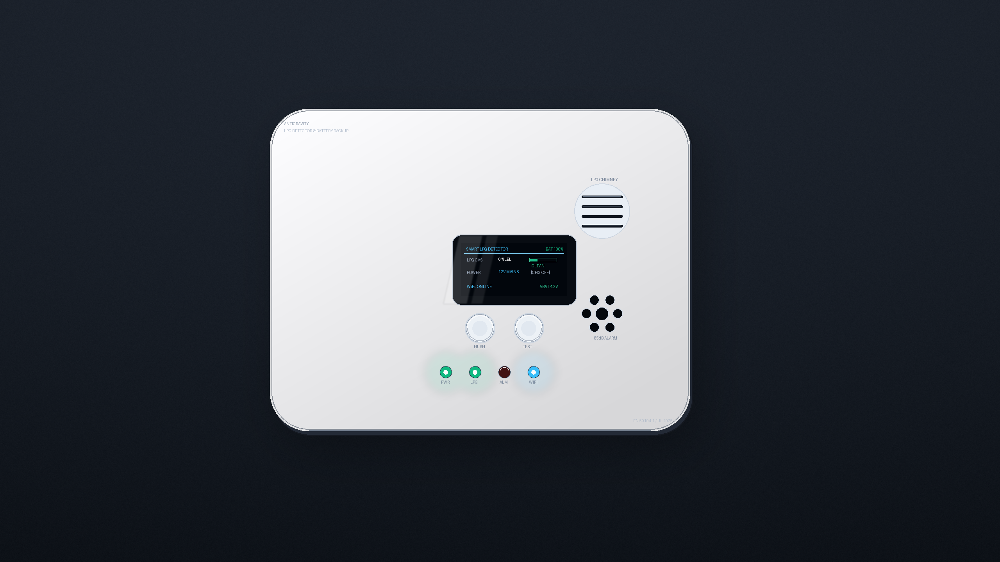

# Smart LPG Gas Detector & Autonomous Battery Backup

[](https://www.kicad.org/)
[-brightgreen.svg)]()
[]()
[]()
[]()

Production-grade, 4-layer smart LPG combustible gas detector hardware platform engineered around the **ESP32-C3** Wi-Fi/BLE microcontroller. Features an integrated **1100mAh LiPo battery backup system** (delivering 3 to 5 hours runtime during AC power outages), intelligent TP4056 charging with automated full-charge current cutoff, DW01A/FS8205A secondary BMS protection, and instant AO3401A power-path switchover.

<p align="center">
  
</p>

> [!TIP]
> - **Interactive 3D Web Viewer:** Inspect real-time 3D rotation, exploded assembly view, PCB ghosting, and battery bay in [`cad/enclosure_viewer.html`](cad/enclosure_viewer.html).
> - **AutoCAD & SolidWorks:** Complete mechanical blueprints, native `.SLDPRT`/`.SLDASM`, and STEP/STL solid models are located in [`cad/`](cad/).
> - **Zero-Collision Guarantee:** Every enclosure aperture and internal boss matches PCB component placement with **$0.00\text{ mm}$ axial error** across all 13 interfaces.

---

## Architecture & System Features (Rev 4.0)

- **Microcontroller:** ESP32-C3-MINI-1 (RISC-V 32-bit single-core, Wi-Fi 4 + Bluetooth 5 LE).
- **LPG Combustible Gas Subsystem (Zone F):**
  - Sensor: **Figaro TGS2610-C00** (MOS combustible gas sensor with natural upward convection draft chimney).
  - High-side PWM-modulated heater driver and precision analog divider readout ($R_L$ load network).
- **Power Management & Dual-Source Power-Path (Zone A):**
  - Primary Input: **12V DC** via Phoenix 2-pin screw terminal block (`J1`).
  - High-Efficiency Buck Regulators:
    - MP1584 / LMR14006 step-down converting 12V to system 5V.
    - Low-noise AP2112K-3.3 LDO converting to stable 3.3V rail.
  - Power-Path Switchover: **AO3401A P-Channel MOSFET** + **B5819W Schottky Diode** provide seamless zero-drop instant switchover between 12V DC and Battery Backup.
- **Autonomous Battery Backup & Smart Charging (Zone E):**
  - Battery: 3.7V **1100mAh LiPo Pouch Cell** housed in a dedicated lower chassis pocket ($52 \times 36 \times 7.5\text{ mm}$), delivering **3 to 5 hours continuous backup operation**.
  - Smart Charger IC: **TP4056** ($500\text{ mA}$ CC/CV charge current, programmed via $R_{\text{PROG}} = 2.4\text{ k}\Omega$).
  - Automated Charge Cutoff: TP4056 internal $C/10$ detection terminates charging cleanly when cell reaches $4.20\text{V} \pm 1\%$ (standby current $< 2\mu\text{A}$).
  - Hardware BMS Protection: **DW01A** battery protection IC paired with **FS8205A** dual N-channel power MOSFET for over-charge ($4.30\text{V}$), over-discharge ($2.40\text{V}$), and short-circuit protection.
- **User Interface & Annunciation (Zone C):**
  - Display: 0.96-inch OLED I2C Display ($128 \times 64$) mounted at $(42.0, 25.0)$ with dedicated bezel frame.
  - Audio: $12.2\text{ mm}$ Piezo Buzzer `LS1` ($85\text{ dB} @ 10\text{ cm}$) aligned with front rosette acoustic sound horn at $(60.0, 16.0)$.
  - Input: Tactile pushbuttons for **TEST** (`SW1` at $45.0, 13.0$) and **HUSH** (`SW2` at $35.0, 13.0$).
  - Visual: 4-Channel SMD LEDs at $Y = 4.00\text{ mm}$: `D4` (Red Alarm), `D5` (Green Normal), `D6` (Yellow Fault), `D7` (Blue Wi-Fi).

---

## Hardware Specifications

| Parameter | Specification |
| :--- | :--- |
| **Dimensions** | 70.0 mm × 50.0 mm |
| **Layer Count** | 4 Layers (F.Cu - In1.Cu GND - In2.Cu Power - B.Cu) |
| **PCB Thickness** | 1.6 mm |
| **Surface Finish** | ENIG (Electroless Nickel Immersion Gold) |
| **Operating Voltage** | 12V DC Nominal (9V to 16V DC range) |
| **Backup Battery** | 3.7V 1100mAh LiPo Pouch Cell (3 to 5 hours runtime) |
| **Sensors Installed** | Figaro TGS2610-C00 (LPG / Combustible Gas) |
| **Target Standards** | Designed referencing UL 1484 / EN 50194 for domestic gas alarms |

---

## Repository Structure

```
co_detector_controller/
├── co_detector_controller.kicad_pro    # KiCad 10 project file
├── co_detector_controller.kicad_sch    # Rev 4.0 schematic (0 ERC errors)
├── co_detector_controller.kicad_pcb    # Rev 4.0 4-layer routed PCB layout (0 DRC errors)
├── co_detector_controller.step         # Complete KiCad PCBA 3D STEP export
├── co_detector_symbols.kicad_sym       # Project custom symbol library
│
├── cad/                                # Mechanical CAD & Enclosure Engineering
│   ├── enclosure_viewer.html           # Interactive 3D Web Viewer (Rev 4.0)
│   ├── render_enclosure_technical.png  # Technical 4-view engineering blueprint
│   ├── smart_dual_gas_detector_render.png # High-resolution 2.5K photorealistic product render
│   ├── autocad/
│   │   └── co_detector_enclosure_perfect.dxf  # AutoCAD Mechanical production drawing
│   ├── dxf/
│   │   └── co_detector_enclosure_production.dxf # 1:1 CNC machining profiles
│   ├── solidworks/
│   │   ├── CO_Enclosure_Chassis_Base.SLDPRT   # Native SolidWorks Base
│   │   ├── CO_Enclosure_Front_Cover.SLDPRT    # Native SolidWorks Cover
│   │   ├── CO_Enclosure_Wall_Bracket.SLDPRT   # Native SolidWorks Bracket
│   │   ├── CO_Enclosure_Assembly.SLDASM       # Native SolidWorks Assembly
│   │   └── *.step                             # ISO 10303-21 B-Rep STEP models
│   └── stl/
│       ├── CO_Enclosure_Chassis_Base.stl      # 3D printable chassis base
│       ├── CO_Enclosure_Front_Cover.stl       # 3D printable front cover
│       └── CO_Enclosure_Wall_Bracket.stl      # 3D printable wall bracket
│
├── reports/                            # Automated verification logs
│   ├── enclosure_physics_clearance_audit.json # 100% Zero-Collision Clearance Report (0.00 mm error)
│   ├── pcb_exact_components.json       # Exact footprint locations extracted from KiCad
│   └── BOM_engineering_master.csv      # Detailed engineering BOM
│
├── docs/
│   └── TOOLING_AND_ASSEMBLY_MANUAL.md  # Production tooling & injection molding manual
│
└── scripts/                            # Automation & verification scripts
    ├── build_lpg_battery_pcb.py        # KiCad PCB layout generator (Rev 4.0)
    ├── generate_schematic.py           # KiCad schematic generator (Rev 4.0)
    ├── extract_exact_pcb_metrics.py    # Metric extraction tool
    ├── generate_autocad_dxf.py         # AutoCAD Mechanical DXF builder
    ├── build_solidworks_native.py      # SolidWorks COM native automation engine
    ├── build_stl_step_direct.py        # High-res binary STL exporter
    ├── verify_enclosure_clearances.py  # Spatial collision verification audit
    ├── render_enclosure_technical.py   # 4-view blueprint renderer
    └── render_photorealistic_product.py# Raymarching photorealistic hero renderer
```

---

## Mechanical Enclosure & Industrial Design

The enclosure is engineered specifically for automated injection molding in **Flame-Retardant PC/ABS (UL 94-V0)** and designed in both **AutoCAD Mechanical** and **SolidWorks**.

<p align="center">
  
</p>

### Enclosure Specifications & Thermal Physics (Rev 4.0)

| Parameter | Specification | Engineering Function |
| :--- | :--- | :--- |
| **Dimensions** | $86.0\text{ mm} \times 66.0\text{ mm} \times 28.0\text{ mm}$ | Compact European squircle ($R = 8.0\text{ mm}$ corners) |
| **Wall Thickness** | $2.40\text{ mm} \pm 0.10\text{ mm}$ | Uniform injection molding nominal thickness |
| **Housing Material** | **PC/ABS UL 94-V0** (e.g. Sabic Cycoloy FR15) | Flame retardancy & high impact toughness |
| **Battery Pocket** | $52.0 \times 36.0 \times 7.5\text{ mm}$ | Internal base cavity isolating 1100mAh LiPo cell |
| **Display Window** | $25.0\text{ mm} \times 14.0\text{ mm}$ ($R = 1.5\text{ mm}$) | Centered at $(42.0, 25.0)$ for 0.96-inch OLED screen |
| **Acoustic Horn** | Helmholtz Resonator ($V \approx 720\text{ mm}^3$) | 7-hole radial rosette at $(60.0, 16.0)$ ($>85\text{ dBA}$ @ 3m) |
| **LPG Chimney** | Top-right convection venting | Natural upward draft above Figaro TGS2610 at $(60.0, 37.0)$ |
| **PCB Mounting** | 4x M2.5 Standoff Bosses ($H = 7.1\text{ mm}$) | Accommodates battery pocket below PCBA |
| **Wall Bracket** | Quick-Mount Slide Plate | Keyholes matching standard $60.0\text{ mm}$ electrical boxes |

---

## License

This project is open-source hardware licensed under the [MIT License](LICENSE).
