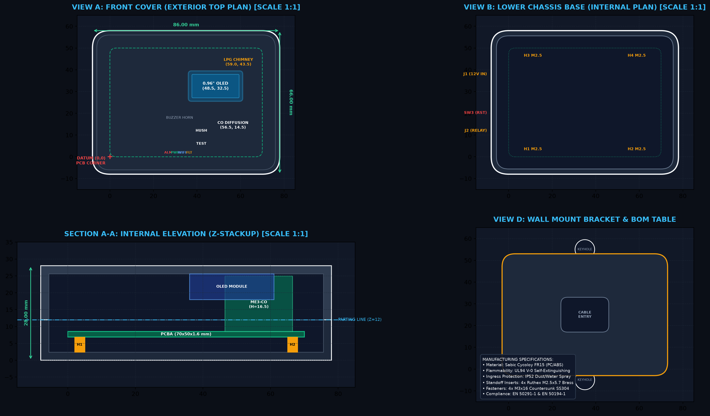

# Smart Dual Gas Detector (CO + LPG) Controller

[](https://www.kicad.org/)
[-brightgreen.svg)]()
[](https://github.com/naoufalelhlou22/co-detector-controller/releases/tag/v2.0.0)
[]()
[]()
[](README_JLCPCB.md)

Production-grade, 4-layer smart dual-gas detector hardware platform designed around the **ESP32-C3** Wi-Fi/BLE microcontroller. Integrates precision analog front-ends for simultaneous monitoring of **Carbon Monoxide (CO)** and **Combustible Liquefied Petroleum Gas (LPG)**.

<p align="center">
  
</p>

> [!TIP]
> - **PCBA Manufacturing:** Ready-to-order Gerbers, schematic PDF, BOM, and CPL files are attached to the [v2.0.0 Release](https://github.com/naoufalelhlou22/co-detector-controller/releases/tag/v2.0.0).
> - **Interactive 3D Viewer:** Preview the enclosure with real-time 3D rotation, exploded view, and thermal airflow in [cad/enclosure_viewer.html](cad/enclosure_viewer.html).
> - **AutoCAD & SolidWorks:** Complete mechanical blueprints and 3D solid models are available in the [`cad/`](cad/) folder.

---

## Features

- **Microcontroller:** ESP32-C3-MINI-1 (RISC-V 32-bit single-core, Wi-Fi 4 + Bluetooth 5 LE).
- **Carbon Monoxide Subsystem (Zone D):**
  - Sensor: **Winsen ME3-CO** (electrochemical cell).
  - Analog Front-End: **TI LMP91000** configurable AFE potentiostat with programmable transimpedance gain (TIA) via $I^2C$.
- **Combustible / LPG Subsystem (Zone F):**
  - Sensor: **Figaro TGS2610-C00** (metal-oxide semiconductor gas sensor).
  - High-side PWM-modulated heater driver and buffered voltage divider analog readout.
- **Power Management (Zone A):**
  - Primary Input: 5V DC via USB-C or screw terminals.
  - 3.3V Step-Down: Low-noise, high-efficiency LDO / buck regulator.
  - Active reverse-polarity, over-voltage, and transient protection.
- **User Interface & Annunciation (Zone C):**
  - Audio: Piezo sounder with transistor buffer for audible emergency alarms.
  - Visual: Status and alarm LEDs (Power, CO Alert, LPG Alert, Fault/WiFi).
  - Input: Tactile switches for Alarm Mute/Hush and Self-Test.
- **Fabrication & Assembly:**
  - 100% single-sided SMT placement (Top side only) for cost-effective PCBA.
  - Verified LCSC part numbers for turn-key assembly via JLCPCB.

---

## Hardware Specifications

| Parameter | Specification |
| :--- | :--- |
| **Dimensions** | 70.0 mm × 50.0 mm |
| **Layer Count** | 4 Layers (Signal Top - GND - 3V3/Power - Signal Bottom) |
| **PCB Thickness** | 1.6 mm |
| **Surface Finish** | ENIG (Electroless Nickel Immersion Gold) recommended |
| **Copper Weight** | 1 oz outer / 1 oz inner |
| **Sensors Installed** | Winsen ME3-CO (CO), Figaro TGS2610 (LPG) |
| **Target Standards** | Designed referencing UL 2034 / EN 50291 acoustic and sensitivity curves |

---

## Repository Structure

```
co_detector_controller/
├── co_detector_controller.kicad_pro    # KiCad 10 project file
├── co_detector_controller.kicad_sch    # Main schematic
├── co_detector_controller.kicad_pcb    # 4-layer routed PCB layout
├── co_detector_symbols.kicad_sym       # Project custom symbol library
├── sym-lib-table                       # Symbol library mapping
├── co_detector_controller_schematic.pdf# High-resolution PDF schematic export
├── README_JLCPCB.md                    # Complete JLCPCB PCBA ordering guide
│
├── fab_jlcpcb/                         # Ready-to-order manufacturing deliverables
│   ├── co_detector_controller_gerbers_jlcpcb.zip # Gerber & Excellon drill archive
│   ├── JLCPCB_BOM.csv                  # Bill of Materials mapped with LCSC part numbers
│   ├── JLCPCB_CPL.csv                  # Centroid / Pick & Place coordinates
│   └── gerbers/                        # Extracted RS-274X layer files
│
├── reports/                            # Automated verification logs
│   ├── drc_stage5.json                 # Design Rules Check report (0 errors, 0 unconnected)
│   ├── erc_report.json                 # Electrical Rules Check report (0 errors)
│   ├── stage5_net_stats.json           # Track, via, and copper plane metrics
│   └── BOM_engineering_master.csv      # Detailed engineering BOM
│
├── audit_rev3/                         # Simulation and firmware verification
│   ├── spice/                          # SPICE netlists and simulation run results
│   ├── run_all_spice_sims.py           # Automated ngspice test runner
│   └── wokwi/                          # Wokwi firmware simulation testbench
│       ├── src/                        # Embedded C++ drivers (pins, power, watchdog)
│       └── test/                       # 18-scenario automated verification testbench
│
├── scripts/                            # KiCad Python automation scripts
│   ├── build_stage4.py                 # Automated PCB placement & routing engine
│   ├── generate_schematic.py           # Schematic generator
│   ├── build_jlcpcb_package.py         # Gerber, BOM, and CPL packager
│   ├── calculate_pcba_costs.py         # JLCPCB assembly cost estimator
│   └── build_3d_models.py              # 3D mechanical model export tool
│
└── 3dmodels/                           # 3D CAD models (VRML / STEP)
```

---

## Mechanical Enclosure & Industrial Design

The enclosure is engineered specifically for automated injection molding in **Flame-Retardant PC/ABS (UL 94-V0)** and designed in both **AutoCAD Mechanical** and **SolidWorks**.

### Enclosure Specifications & Thermal Physics (Rev 3.0)

| Parameter | Specification | Engineering Function |
| :--- | :--- | :--- |
| **Dimensions** | $86.0\text{ mm} \times 66.0\text{ mm} \times 28.0\text{ mm}$ | Compact European squircle ($R = 8.0\text{ mm}$ corners) |
| **Wall Thickness** | $2.40\text{ mm} \pm 0.10\text{ mm}$ | Uniform injection molding nominal thickness |
| **Housing Material** | **PC/ABS UL 94-V0** (e.g. Sabic Cycoloy FR15) | High impact strength & fire-safety certification |
| **Display Window** | $25.0\text{ mm} \times 14.0\text{ mm}$ ($R = 1.5\text{ mm}$) | 0.96-inch OLED screen aperture with internal PMMA lens shelf |
| **Acoustic Horn** | Helmholtz Resonator ($V \approx 720\text{ mm}^3$) | 7-hole radial rosette tuned to $4.2\text{ kHz}$ ($>85\text{ dBA}$ @ 3m) |
| **Thermal Chimney** | Top perimeter convection venting | Natural upward draft isolating TGS2610 $280\text{ mW}$ heater ($\Delta Y = 29\text{ mm}$) |
| **PCB Mounting** | 4x M2.5 Standoff Bosses ($H = 4.5\text{ mm}$) | Sized for Ruthex M2.5 heat-set brass inserts (pitch $63\times43\text{ mm}$) |
| **Wall Bracket** | Quick-Mount Slide Plate | Universal EU/US $60.0\text{ mm}$ junction box keyholes |

### CAD Deliverables Directory (`cad/`)
- **Interactive 3D Web Viewer:** [`cad/enclosure_viewer.html`](cad/enclosure_viewer.html) (open in any web browser for real-time 3D exploded view, section cut, and PCBA alignment inspection).
- **AutoCAD Mechanical Package (`cad/autocad/` & `cad/dxf/`):**
  - Master Production Blueprint (ISO A3): [`cad/autocad/co_detector_enclosure_perfect.dxf`](cad/autocad/co_detector_enclosure_perfect.dxf)
  - 1:1 CNC Machining Profiles: [`cad/dxf/co_detector_enclosure_production.dxf`](cad/dxf/co_detector_enclosure_production.dxf)
- **SolidWorks Package (`cad/solidworks/`):**
  - Native Part Models: `CO_Enclosure_Chassis_Base.SLDPRT`, `CO_Enclosure_Front_Cover.SLDPRT`, `CO_Enclosure_Wall_Bracket.SLDPRT`
  - Native Assembly: `CO_Enclosure_Assembly.SLDASM`
  - ISO 10303-21 B-Rep STEP Files: `CO_Enclosure_Chassis_Base.step`, `CO_Enclosure_Front_Cover.step`, `CO_Enclosure_Wall_Bracket.step`, `CO_Enclosure_Assembly.step`
- **Additive Manufacturing (`cad/stl/`):**
  - High-Resolution Binary STL: `CO_Enclosure_Chassis_Base.stl`, `CO_Enclosure_Front_Cover.stl`, `CO_Enclosure_Wall_Bracket.stl`

---

## Manufacturing & Assembly

For complete step-by-step instructions on ordering boards and PCBA through JLCPCB, see the [JLCPCB Ordering Guide](README_JLCPCB.md).

> [!CAUTION]
> Chemical gas sensors (**Winsen ME3-CO** and **Figaro TGS2610**) must **NOT** be passed through the SMT reflow oven. Solder sockets or hand-solder sensors post-reflow.

---

## License

This project is open-source hardware licensed under the [MIT License](LICENSE) (or CERN-OHL-P / user preferred license).

