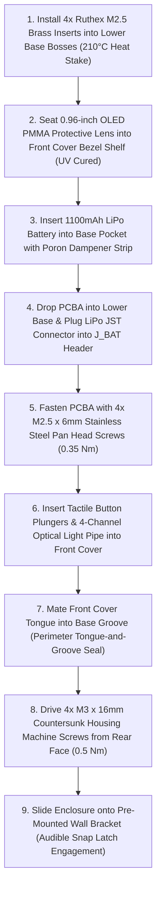

# Smart LPG Gas Detector & Autonomous Battery Backup - Tooling & Production Assembly Manual
**Revision:** 4.0 (Ground-Truth PCBA Aligned)  
**Document ID:** AGY-DOC-PROD-401  
**Target Manufacturing Process:** Automated Multi-Cavity Plastic Injection Molding & SMT Integration  

---

## 1. Tooling Specifications (Injection Mold Design)

| Mold Parameter | Engineering Value | Notes |
| :--- | :--- | :--- |
| **Resin Material** | Sabic Cycoloy FR15 (PC/ABS blend) | Flame-retardant UL94 V-0, high impact toughness |
| **Mold Steel (Cavity/Core)**| DIN 1.2343 (AISI H11 ESR) hardened to 50-52 HRC | High polishability & wear resistance |
| **Number of Cavities** | 2 + 2 Family Mold (Base, Cover, Bracket, Lens) | Balanced hot-runner system with submarine gates |
| **Nominal Wall Thickness** | $2.40\text{ mm} \pm 0.10\text{ mm}$ uniform | Prevents sink marks, warpage, and internal voids |
| **Draft Angles** | $1.5^\circ$ nominal on all vertical shutoff surfaces | $0.5^\circ$ minimum on shallow internal ribs |
| **Shrinkage Factor** | $0.5\% - 0.7\%$ ($0.005 - 0.007\text{ mm/mm}$) | Compensated in primary tooling electrode EDM |
| **Surface Finish** | VDI 27 (Exterior Matte) / SPI-A2 (Light Pipes) | Glare reduction on front face; mirror finish on optics |
| **Internal Battery Bay** | $52.0 \times 36.0 \times 7.5\text{ mm}$ integrated lower base pocket | Accommodates 1100mAh LiPo pouch cell with shock pad |

---

## 2. Fastening & Mechanical Assembly Sequence

---

## 3. Ground-Truth PCBA Interface Alignment Table (Rev 4.0)

| Enclosure Aperture | Connected PCB Component | CAD Center $(X, Y)$ [mm] | Clearance |
| :--- | :--- | :--- | :--- |
| **OLED Bezel Window** | J4 Header / 0.96" OLED Module | $(42.00, 25.00)$ | $25.0 \times 14.0\text{ mm}$ ($+0.5\text{ mm}$ float) |
| **SW2 Button (Hush)** | PTS647 Tactile Switch | $(35.00, 13.00)$ | $\varnothing 5.5\text{ mm}$ ($+0.5\text{ mm}$ stem radial) |
| **SW1 Button (Test)** | PTS647 Tactile Switch | $(45.00, 13.00)$ | $\varnothing 5.5\text{ mm}$ ($+0.5\text{ mm}$ stem radial) |
| **Optical Status LEDs**| D4, D5, D6, D7 (Alarm/Norm/Fault/WiFi)| $Y = 4.00, X \in [28.0, 34.0, 40.0, 46.0]$ | 4x $\varnothing 2.0\text{ mm}$ light guide ports |
| **Acoustic Rosette Horn**| LS1 Piezo Buzzer 85dB | $(60.00, 16.00)$ | 7-hole radial acoustic port array |
| **LPG Thermal Chimney**| Figaro TGS2610-C00 Sensor | $(60.00, 37.00)$ | Upward natural convection venting slots |
| **Terminal J1 Cutout** | 12V DC Power Screw Terminal | Left Wall $(Y = 38.00)$ | $12.0 \times 10.5\text{ mm}$ split opening |
| **Reset SW3 Pinhole** | Hardware Master Reset Switch | Left Wall $(Y = 20.00)$ | $\varnothing 2.5\text{ mm}$ recessed access |
| **4x Standoff Bosses** | H1, H2, H3, H4 ($H = 7.1\text{ mm}$) | $(3.5, 3.5), (66.5, 3.5), (3.5, 46.5), (66.5, 46.5)$ | Sized for M2.5 heat-set brass inserts |
| **Battery Pocket** | 1100mAh LiPo Backup Cell | Lower Base Floor $(Z: 0.8..8.3\text{ mm})$ | $52.0 \times 36.0 \times 7.5\text{ mm}$ depression |
